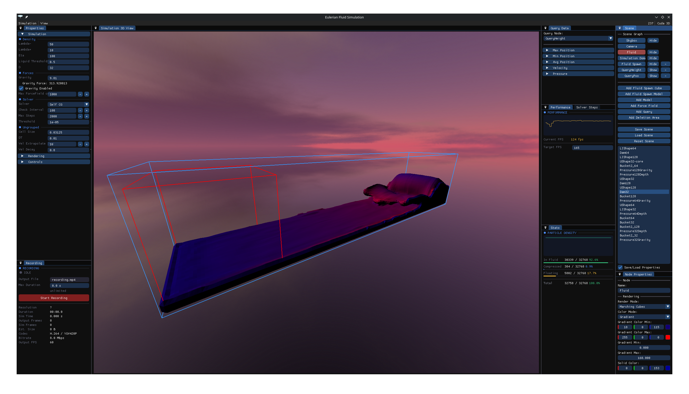
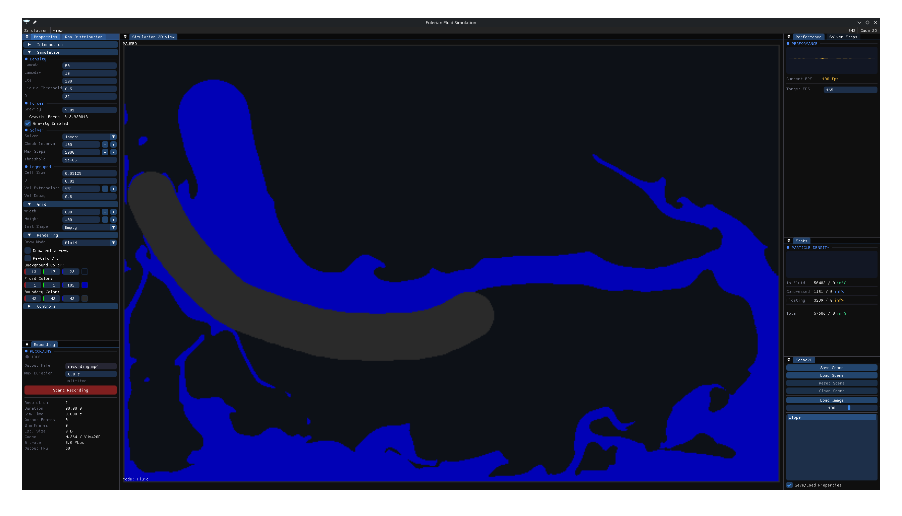
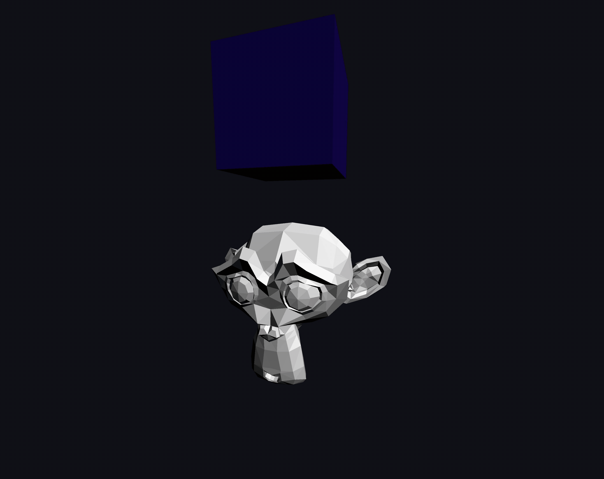

<h1 align="center">
  
  Eulerian Fluid Simulation
</h1>

A 2D and 3D fluid simulation project implementing Eulerian fluid simulation methods on the CPU and GPU

# Description
This project implements a purly Eulerian fluid simulation based on the following publications:
* Jos Stam. “Stable fluids”. In: Proceedings of the 26th Annual Conference on Computer Graphics and Interactive Techniques. SIGGRAPH ’99. USA: ACM Press/Addison-Wesley Publishing Co., 1999, pp. 121–128. isbn: 0201485605.
* Nuttapong Chentanez and Matthias Müller. “Mass-Conserving Eulerian Liquid Simulation”. In: IEEE Transactions on Visualization and Computer Graphics 20.1 (2014), pp. 17–29.

## License

This project is licensed under the MIT License. See [LICENSE](LICENSE)
for details.

### Third-Party Libraries

This project uses several third-party libraries, each distributed under
its respective license:

- Dear ImGui: MIT License
- GLM: MIT License
- Eigen: Mozilla Public License 2.0
- stb: MIT License
- tinyobjloader: MIT License
- nlohmann/json: MIT License
- ImGuiFileDialog: MIT License
- ImGuizmo: MIT License
- ImPlot: MIT License

The corresponding license texts and copyright notices are provided
in `THIRD_PARTY_LICENSES/`.

# <p>Features</p>
- **2D and 3D simulation**
- **Multiple implementations:** CPU, OpenGL compute shaders, and CUDA
- **Scene editing:** Create and modify simulation scenes with static boundaries
- **Scene management:** Save and load scenes
- **Profiling and measurements:** Inspect simulation performance and properties
- **Video recording:** Export simulation recordings in supported builds

# Usage
The simulation currently targets Linux. Windows support may be possible, but it has not been tested.
Precompiled Linux releases are provided
The CUDA-enabled releases require a compatible NVIDIA GPU and driver. 
The supported GPU architectures depend on the CUDA version used to build the release.
Video recording is available only in the FFmpeg-enabled release.

## Build
### Requirements
- CMake 3.20 or newer
- A C++ compiler with C++20 support
- Git
- OpenGL
- GLFW
- FreeGLUT
- X11 development libraries
- `pkg-config`

For CUDA-enabled builds, you also need the NVIDIA CUDA Toolkit and a compatible NVIDIA driver.

For FFmpeg-enabled builds, you need the development libraries for:
- `libavformat`
- `libavcodec`
- `libavutil`
- `libswscale`

On Debian-based distributions, the required packages can be installed with:
```bash
sudo apt install build-essential cmake git \
    libgl1-mesa-dev libglfw3-dev freeglut3-dev \
    libx11-dev pkg-config
```
For CUDA support, install the NVIDIA CUDA Toolkit separately.

For FFmpeg support, install the development packages:
```bash
sudo apt install libavformat-dev libavcodec-dev \
    libavutil-dev libswscale-dev
```
The project uses Git submodules for some dependencies. They are initialized automatically during CMake configuration, provided Git and network access are available.

### Build with CUDA and FFmpeg
```bash
cmake -S . -B build-cuda-ffmpeg \
    -DCMAKE_BUILD_TYPE=Release

cmake --build build-cuda-ffmpeg --parallel
```
CUDA is enabled when CMake finds the CUDA Toolkit. FFmpeg support is enabled when all required FFmpeg development libraries are found.

### Build with CUDA but without FFmpeg
Install the CUDA Toolkit, but do not install the FFmpeg development libraries. Then run:
```bash
cmake -S . -B build-cuda \
    -DCMAKE_BUILD_TYPE=Release

cmake --build build-cuda --parallel
```
If FFmpeg is installed on your system, CMake will enable recording automatically.

### Build without CUDA and FFmpeg
Use a system without the CUDA Toolkit and the FFmpeg development libraries:
```bash
cmake -S . -B build-cpu \
    -DCMAKE_BUILD_TYPE=Release

cmake --build build-cpu --parallel
```
This build does not include CUDA acceleration or video recording.

### Run
After a successful build, run the executable from the build directory:
```bash
./build-cuda-ffmpeg/EulerianFluidSimulation
```

The build process copies the required assets into the build directory.

## <p1>Controls</p1>
### General (2D and 3D)

| Shortcut | Action |
|---|---|
| `Ctrl + R` | Rebuild the simulation |
| `R` | Reset the simulation |
| `P` / `Space` | Pause or resume the simulation |
| `Ctrl + S` | Advance the simulation by one step |
| `/` | Search simulation properties |

### 2D Controls

| Shortcut | Action |
|---|---|
| `M` | Cycle through Force, Boundary, and Fluid editing modes |
| Left mouse button | Add to the scene, depending on the active mode |
| Right mouse button | Remove from the scene, depending on the active mode |
| Mouse wheel | Change brush size |
| `Shift` + mouse wheel | Change brush size faster |

### 3D Controls

| Shortcut | Action |
|---|---|
| `W`, `A`, `S`, `D`, `E`, `Q` | Move the camera |
| Arrow keys | Change the camera direction |
| Right mouse button | Change the camera direction |
| `Ctrl` + left mouse button | Pan the camera |
| `F1` | Set the front view |
| `F2` | Set the side view |
| `F3` | Set the top view |
| `F5` | Switch to perspective projection |
| `F6` | Switch to orthographic projection |

# Known Limitations and Bugs
While the simulations should be the same regardless of the implementation used, there might be differences

The following are bugs, which are know to exist but should not impact the simulation. 
This simulation already took too long to implement and therefore there currently are not plans to fix these bugs.
- **Gizmo:** Can behave incorrectly for grid-aligned nodes, particularly when they are moved using the Node Properties window.
- **Viewport scaling:** The viewport scale is incorrect.
- **Parameter scaling:** The effects of Lambda and Eta do not automatically scale with cell size.
- **Particle density statistics:** Some statistics may not be initialized correctly.
- **2D forces:** The 2D force implementation has known issues.
- **Boundaries:** :(

# Screenshots
<h1 align="center">
  
  
</h1>

# Demo
<h1 align="center">
  
</h1>
